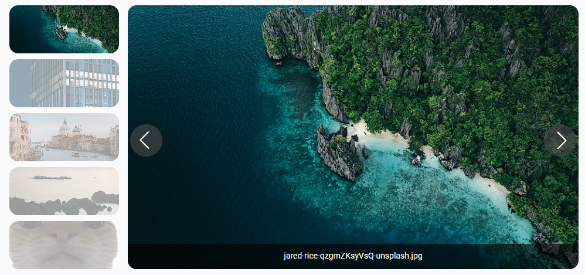

dynamikasolucoesweb/laravel-carousel-slider-1
=========================


Um componente Blade robusto para carrosséis de imagens usando Swiper.js 11, com suporte nativo para Spatie Media Library, layouts flexíveis (miniaturas verticais/horizontais) e Lightbox integrado.



Instalação
------------
A maneira preferida de instalar esta extensão é através do [composer] [composer](http://getcomposer.org/download/).

Ou corre

```SHELL
$ composer require dynamikasolucoesweb/laravel-carousel-slider-1 "*"
```

ou adicione

```JSON
"dynamikasolucoesweb/laravel-carousel-slider-1": "*"
```

à seção `require` do seu arquivo `composer.json`.

Publique os assets (CSS/JS) necessários:

```SHELL
$ php artisan vendor:publish --tag=carousel-assets-1
```

🛠 Configuração
------------
Você pode utilizar a biblioteca de duas formas:

1. Via CDN (Plug & Play)
Ideal para quem quer rapidez. O componente injetará automaticamente o Swiper.js e os estilos necessários das CDNs oficiais.
Basta adicionar as stacks @stack('styles') e @stack('scripts') no seu layout principal (ex: app.blade.php).

2. Via Vite (Performance)
Para melhor performance e evitar requisições externas, importe as dependências no seu bundle principal.

```SHELL
npm install swiper
```

No seu resources/js/app.js:
```SHELL
import Swiper from 'swiper/bundle';
import 'swiper/css/bundle';
window.Swiper = Swiper;
```

🛠 Como Usar
------------
Chame o componente em qualquer view Blade passando uma coleção de mídias (Spatie) ou um array simples.

```html
<x-carousel-slider :items="$produto->getMedia('galeria')" versionImage="mid" />
```

exemplo completo:

```html
<x-carousel-slider-1 
    :items="$imagens" 
    id_custom="galeria-principal"
    versionImage="mid"
    layout="right"
    :autoplay="true"
    :delay="5000"
    :cdn="true"
    class="custom-margin"
/>
```

⚙️ Propriedades (Props)
------------

| Propriedade | Tipo | Padrão | Descrição |
| :------- | :--: | :--: | :---------- |
| items | Collection/Array | [] | Lista de imagens (Spatie Media ou Array com src). |
| id_custom | string | carousel-uniqueid | ID único para o container. |
| versionImage | string | '' | Conversão do Spatie Media Library a ser exibida. |
| layout | string | 'bottom' | Posição das thumbs (top, bottom, left, right, notumbs). |
| autoplay | boolean | false | Ativa a transição automática. |
| delay | integer | 3000 | Tempo em ms para o autoplay. |
| useLegenda | boolean | true | Exibe legendas das imagens (custom_properties). |
| cdn | boolean | false | Se true, carrega Swiper e Scripts via CDN. |

Authors
------------
Giordani da Silveira dos Santos - giordani@dynamika.com.br

--------------------------------------------------------------------------------------------------------------
[](https://dynamika.com.br)
This project is under [BSD-3-Clause](https://opensource.org/licenses/BSD-3-Clause) license.